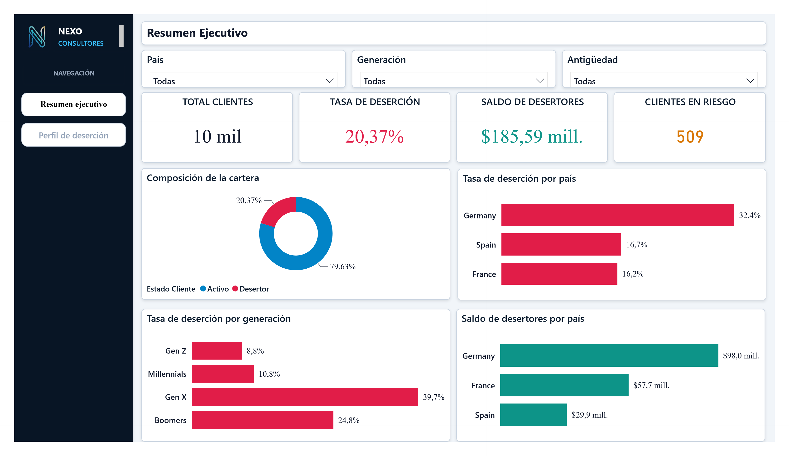
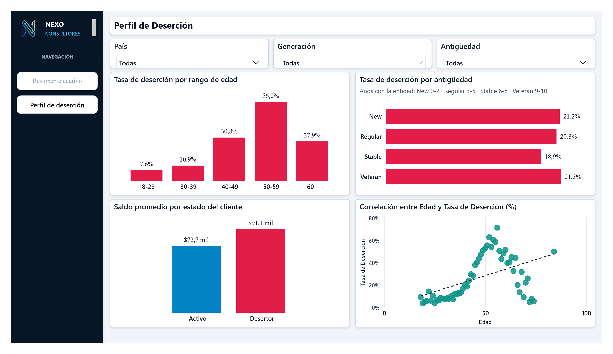

<div align="right">
  <a href="README.md">English</a> | <a href="README.es.md"><strong>Español</strong></a>
</div>

# Análisis de Deserción y Retención Bancaria (Power BI)

Proyecto integral de **Inteligencia de Negocios (BI) y Análisis Exploratorio de Datos (EDA)** para una cartera bancaria de tarjetas de crédito, orientado a identificar patrones históricos de abandono (*churn*), cuantificar el saldo asociado y respaldar estrategias preventivas de retención.

---

## Resumen Ejecutivo e Indicadores (KPIs)

| Indicador | Valor | Contexto de Negocio |
|---|---|---|
| **Total de Clientes** | **10,000** | Cartera distribuida en Alemania, Francia y España |
| **Tasa de Deserción** | **20.37%** | Aproximadamente 1 de cada 5 clientes cerró su cuenta |
| **Saldo de Desertores** | **$185.59 mill.** | Capital total asociado a clientes que abandonaron |
| **Clientes en Riesgo** | **509** | Clientes activos priorizados para seguimiento preventivo |

---

## Vistas del Dashboard

### 1. Resumen Ejecutivo
Indicadores clave, composición de la cartera, tasa de deserción por país y generación, y saldo de desertores por país, con filtros dinámicos por **País**, **Generación** y **Antigüedad**.



### 2. Perfil de Deserción
Análisis por **rango de edad**, **antigüedad**, **saldo promedio por estado del cliente** y **correlación entre edad y tasa de deserción**.



---

## Hallazgos Clave

- **La edad es el principal factor asociado al abandono (`r = +0.28`):** El rango de **50–59 años** alcanza un **56.0%** de deserción (48.89% en el segmento 45–65 en el EDA consolidado), frente al **7.6%** en clientes de 18–29 años.
- **Riesgo de liquidez por saldo (`r = +0.12`):** Quienes abandonan tienen un saldo promedio superior (**$91.1 mil** frente a **$72.7 mil** en activos; mediana **109.2k** vs. **91.6k**).
- **Concentración geográfica:** **Alemania** registra la mayor deserción (**32.4%**) y **$98.0 mill.** en saldo de desertores, prácticamente el doble que **España (16.7%)** y **Francia (16.2%)**.
- **Antigüedad homogénea:** Las tasas oscilan entre **18.9% y 21.3%** entre `New`, `Regular`, `Stable` y `Veteran`.

---

## Estructura del Repositorio

```text
├── Dashboard-NEXO.pbix                 # Archivo editable de Power BI Desktop
├── data/
│   └── transacciones_clientes.csv      # Dataset integrado
├── docs/
│   ├── Dashboard-NEXO.pdf              # Exportación PDF del tablero
│   └── Project_Brief.pdf               # Documento de alcance, diccionario de datos y recomendaciones
└── assets/
    ├── dashboard_executive_summary.png
    └── dashboard_churn_profile.png
```

---

**Autor:** Luis Armando Castillo López — *Data Engineer & BI* (Proyecto Nexo Consultores)
