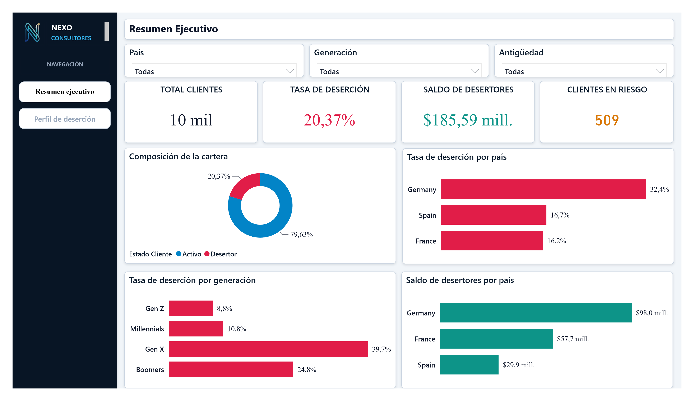
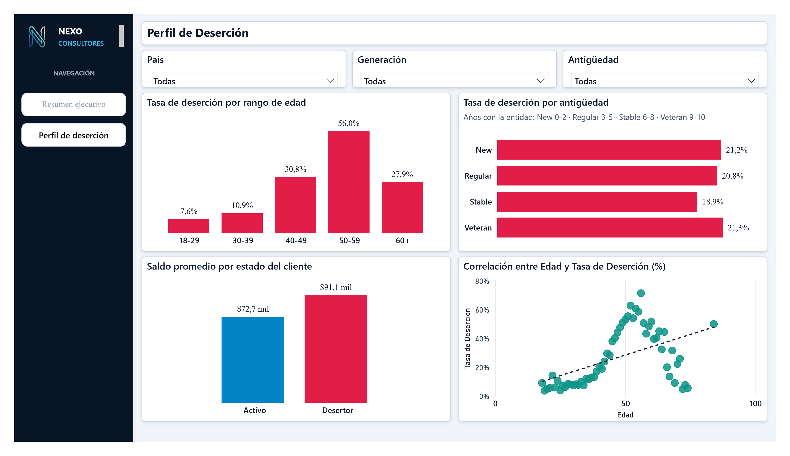

<div align="right">
  <a href="README.md"><strong>English</strong></a> | <a href="README.es.md">Español</a>
</div>

# Bank Customer Churn & Retention Analytics (Power BI)

End-to-end **Business Intelligence & Exploratory Data Analysis (EDA)** project for a retail banking credit card portfolio, designed to identify historical churn patterns, quantify capital at risk, and support data-driven retention strategies.

---

## Executive Summary & KPIs

| Metric | Value | Business Context |
|---|---|---|
| **Total Customers** | **10,000** | Customer base across Germany, France, and Spain |
| **Churn Rate** | **20.37%** | ~1 in 5 customers closed their accounts |
| **Churned Capital (Balance)** | **$185.59M** | Total account balance associated with churned customers |
| **At-Risk Customers** | **509** | Active customers flagged for retention follow-up |

---

## Dashboard Views

### 1. Executive Summary (`Resumen Ejecutivo`)
High-level KPIs, portfolio composition, churn rate by country and generation, and churned balance distribution, with interactive slicers for **Country**, **Generation**, and **Tenure**.



### 2. Churn Profile (`Perfil de Deserción`)
Deep-dive segmentation by **age bracket**, **tenure group**, **average balance comparison**, and **age vs. churn rate correlation**.



---

## Key Analytical Findings

- **Age is the strongest churn driver (`r = +0.28`):** Customers aged **50–59** reach a **56.0%** churn rate (48.89% across the 45–65 bracket in the consolidated EDA), compared to **7.6%** for ages 18–29.
- **High-balance liquidity risk (`r = +0.12`):** Churned customers hold a higher average balance (**$91.1k** vs. **$72.7k** for active customers; median **109.2k** vs. **91.6k**), indicating the bank is losing high-value accounts.
- **Geographic concentration:** **Germany** shows a **32.4%** churn rate and **$98.0M** in churned balance — roughly double the churn rate of **Spain (16.7%)** and **France (16.2%)**.
- **Tenure is relatively flat:** Churn rates remain between **18.9% and 21.3%** across tenure groups (`New`, `Regular`, `Stable`, `Veteran`), meaning tenure alone does not explain attrition.

---

## Data Pipeline & Methodology

1. **Data Sourcing & Integration:** Consolidated customer and transaction datasets (`CustomerId` primary key, ~29.7k transaction rows).
2. **Data Cleaning Rules:**
   - Removed records missing `CustomerId`, `TransactionDate`, or `Amount`.
   - Imputed missing `Channel` values as `"Sin especificar"` to preserve transaction volume.
   - Removed technical noise (`RowNumber`) and normalized negative `Amount` values via absolute value.
3. **EDA & Statistical Checks:** Historical transaction volume trend, IQR outlier detection (`$3.04`–`$619.15` normal bounds), boxplots, and correlation matrix.
4. **Power BI Modeling & DAX:** Star/consolidated relational model with DAX measures for churn rate, churned balance, and risk segmentation.

---

## Repository Structure

```text
├── Dashboard-NEXO.pbix                 # Power BI Desktop report
├── data/
│   └── transacciones_clientes.csv      # Cleaned/integrated dataset
├── docs/
│   ├── Dashboard-NEXO.pdf              # Static PDF export
│   └── Project_Brief.pdf               # Full project brief, data dictionary & recommendations
└── assets/
    ├── dashboard_executive_summary.png
    └── dashboard_churn_profile.png
```

---

**Author:** Luis Armando Castillo López — *Data Engineer & BI Developer* (Nexo Consultores project)
